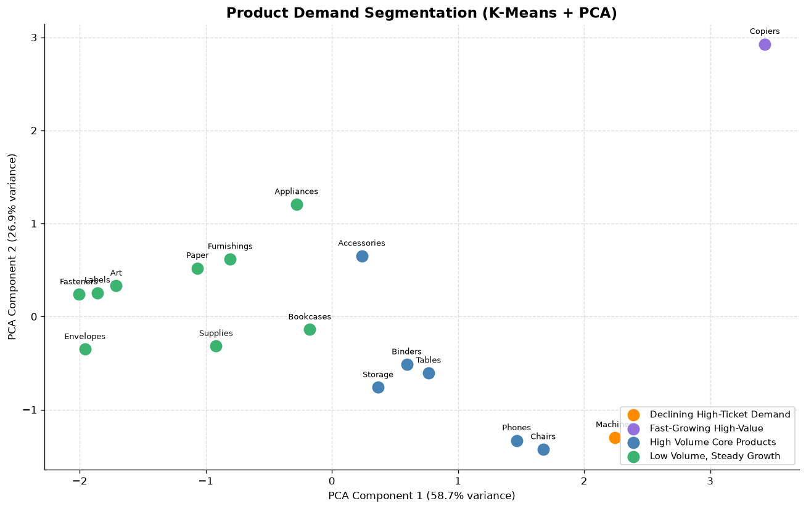

# 📊 End-to-End Sales Forecasting & Demand Intelligence System

A complete sales forecasting and demand intelligence project built on 4 years of retail (Superstore) sales data. It covers time series analysis, three forecasting models, anomaly detection, product demand segmentation, and an interactive Streamlit dashboard.

Built during the **XYlofy AI** internship (Weeks 3 & 4).

🌐 **Live Dashboard:** [Open the app](https://salesforecasting-aswhafazejvzseosr4c6or.streamlit.app/)

   


---

## 🎯 Project Overview

Retail teams need to know **how much they will sell, when sales behave unusually, and which products need more stock**. This project answers those three questions with data:

1. **Forecast** monthly sales with three different models and compare them
2. **Detect** unusual sales weeks with two anomaly detection methods
3. **Segment** product sub-categories by demand behavior to guide stocking decisions

The results are packaged into a 4-page interactive dashboard and a short executive report for finance and supply chain teams.

---

## 📦 Dataset

| Item | Detail |
|------|--------|
| **Dataset** | Superstore Sales (`train.csv`), [Kaggle - Superstore Sales](https://www.kaggle.com/datasets/rohitsahoo/sales-forecasting) |
| **Size** | 9,800 rows, 18 columns |
| **Time period** | January 2015 - December 2018 |
| **Categories** | Furniture, Technology, Office Supplies |
| **Regions** | West, East, Central, South |

---

## 🗂️ Project Structure

```
sales-forecasting-demand-intelligence/
│
├── analysis.ipynb          ← Jupyter notebook (Tasks 1-6)
├── app.py                  ← Streamlit interactive dashboard (4 pages)
├── requirements.txt        ← Python dependencies
├── summary.docx            ← 2-page executive business report (CFO / supply chain)
├── train.csv               ← Superstore Sales dataset
│
└── charts/                 ← Saved chart images (.png)
    ├── monthly_sales_trend.png
    ├── decomposition.png
    ├── stationarity_check.png
    ├── sarima_forecast.png
    ├── prophet_forecast.png
    ├── prophet_components.png
    ├── xgboost_forecast.png
    ├── segment_forecasts.png
    ├── anomaly_detection.png
    ├── elbow_method.png
    └── product_clusters.png
```

---

## ✅ Tasks Completed

| Task | Description |
|------|-------------|
| Task 1 | Data loading & deep exploration (4 business questions answered) |
| Task 2 | Time series analysis, decomposition & stationarity (ADF) test |
| Task 3 | Sales forecasting with SARIMA, Prophet, and XGBoost |
| Task 4 | Category & region level forecasting |
| Task 5 | Anomaly detection with Isolation Forest and rolling Z-Score |
| Task 6 | Product demand segmentation with K-Means and PCA |
| Task 7 | Interactive Streamlit dashboard (`app.py`) |
| Task 8 | Executive business report (`summary.docx`) |

---

## 🤖 Models Built

### Forecasting models (Task 3)
| Model | Type | Description |
|-------|------|-------------|
| **SARIMA(1,1,1)(1,1,1,12)** | Statistical | Classical time series model with yearly seasonality |
| **Prophet** | Industry standard | Meta's forecasting library, handles trend and seasonality |
| **XGBoost + lag features** | Machine learning | Time series converted into a supervised problem (lags, rolling mean, month, quarter) |

### Other models
| Model | Task | Purpose |
|-------|------|---------|
| **Isolation Forest** | Task 5 | ML-based anomaly detection |
| **Z-Score (rolling)** | Task 5 | Statistical anomaly detection |
| **K-Means (k = 4)** | Task 6 | Product demand segmentation |
| **PCA** | Task 6 | 2D visualization of the clusters |

---

## 📈 Key Results

### Business findings
- **Total revenue (2015-2018):** $2,261,537 across 9,800 orders
- **Revenue growth:** +50.5% from 2015 to 2018
- **Top category:** Technology ($827,456, 36.6% of revenue)
- **Top region:** West ($710,220), also the fastest growing region (+70% from 2015 to 2018)
- **Seasonality:** strong and repeating every year, with peaks in Q4 and a dip in early months
- **Average shipping time:** about 4.0 days

### Forecast comparison (test set: Oct-Dec 2018)

The models were trained on 45 months (Jan 2015 - Sep 2018) and tested on the last 3 months.

| Model | MAE | RMSE | MAPE |
|-------|-----|------|------|
| SARIMA | $19,244 | $19,950 | 20.5% |
| Prophet | $20,296 | $22,487 | 21.9% |
| **XGBoost** 🏆 | **$16,812** | $20,181 | **16.6%** |

| Month | Actual | SARIMA | Prophet | XGBoost |
|-------|--------|--------|---------|---------|
| October 2018 | $77,448 | $60,332 | $51,084 | $71,188 |
| November 2018 | $117,938 | $91,458 | $90,045 | $85,681 |
| December 2018 | $83,030 | $97,168 | $89,661 | $71,111 |

**Best model: XGBoost**, with the lowest MAE and MAPE. Prophet is the easiest to explain to non-technical stakeholders.

### Anomaly detection
- **Isolation Forest** flagged 15 unusual weeks and **Z-Score** flagged 6
- Only **2 weeks** (2015-03-16 and 2017-10-02, both sales spikes) were flagged by **both** methods, making them the highest-confidence anomalies

### Product segmentation
17 product sub-categories were grouped into 4 demand segments with K-Means, using total sales, YoY growth, volatility, and average order value. PCA captures **85.5%** of the variance in 2 dimensions.



| Segment | Products | Avg YoY growth | Suggested stocking strategy |
|---------|----------|----------------|-----------------------------|
| **High Volume Core Products** | Phones, Chairs, Storage, Tables, Binders, Accessories | +56% | Protect availability: keep healthy safety stock and replenish on a regular cycle |
| **Low Volume, Steady Growth** | Bookcases, Appliances, Furnishings, Paper, Supplies, Art, Envelopes, Labels, Fasteners | +55% | Keep lean inventory, order in small batches, review quarterly |
| **Fast-Growing High-Value** | Copiers | +286% | Increase stock above last year, review monthly because demand is volatile |
| **Declining High-Ticket Demand** | Machines | -59% | Gradually reduce inventory, clear stock with promotions |

---

## ⚠️ Limitations

- The test window is only **3 months**, so the differences between the three models are small and should be read with caution
- Only 45 months of training data are available, which limits how much seasonality the models can learn
- Two segments (Copiers and Machines) contain a single product each, so they behave more like outliers than groups
- Anomaly "possible causes" in the dashboard are hints for investigation, not confirmed reasons

---

## 🚀 How to Run

### 1. Install dependencies
```bash
pip install -r requirements.txt
```

### 2. Run the notebook
Open `analysis.ipynb` in VS Code or Jupyter (keep `train.csv` in the same folder) and click **Run All**.

### 3. Launch the Streamlit dashboard
```bash
streamlit run app.py
```
Opens at `http://localhost:8501`

---

## 🌐 Dashboard Pages

| Page | Description |
|------|-------------|
| 📊 Sales Overview | Sales by year, monthly trend, region and category charts |
| 🔮 Forecast Explorer | Choose category or region and forecast horizon for a live Prophet forecast |
| 🚨 Anomaly Report | Anomaly chart and table of unusual weeks with possible-cause hints |
| 🎯 Product Demand Segments | Cluster chart and suggested stocking strategy per segment |

---

## 🛠️ Tools & Libraries

| Library | Purpose |
|---------|---------|
| `pandas`, `numpy` | Data loading and manipulation |
| `matplotlib`, `seaborn` | Static charts |
| `plotly` | Interactive charts in the dashboard |
| `statsmodels` | SARIMA model, ADF test, decomposition |
| `prophet` | Prophet forecasting |
| `xgboost` | ML-based time series forecasting |
| `scikit-learn` | Isolation Forest, K-Means, PCA, metrics |
| `streamlit` | Interactive web dashboard |

---

*Built during the XYlofy AI Internship (Weeks 3 & 4)*
